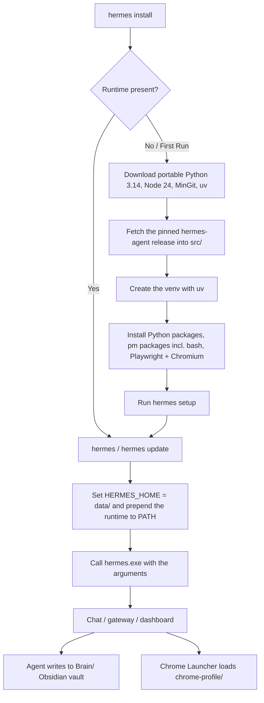

# <p align="center">🛸 Hermes Agent — Portable for Windows</p>

<p align="center">
  
  
  
  
</p>

---

<p align="center">
  <strong>Run a fully self-contained, self-improving AI agent from a single folder or USB drive.</strong><br>
  No global installation. Zero host pollution. All conversations, configs, memories, and skills stay inside your folder.
</p>

<p align="center">
  <a href="https://youtu.be/gL220WHXWeo" target="_blank">
    
  </a>
  <br>
  <em>📺 <strong>Watch the Setup & Demo Video:</strong> Click the image above for the step-by-step walkthrough. The recording shows the classic <code>launch.bat</code> menu — <code>hermes install</code> performs the same setup from the terminal.</em>
</p>

This is the **Windows edition** of the portable build. It keeps every topic of
[README.md](README.md) and adapts it to Windows: the primary entry point is `hermes.cmd`
instead of the menu, and the examples are `cmd` instead of `bash`. macOS, Linux, the
cross-platform layout and the original launcher documentation remain in
[README.md](README.md).

---

## 🆕 What's New in portable-v1.9.2 (2026-11-20)

*   **Hermes Agent v0.23.3**, pinned in `VERSION` (`hermes_agent_ref`, commit `caafe538`) — every OS installs exactly that release; `hermes update` installs it, `hermes update --check` verifies that installed release, pin and origin agree.
*   **`hermes.cmd` — the Windows launcher.** `launch.bat` is a menu: it handles setup, repair, update and the gateway, but it ignores most of `hermes.exe`'s own arguments. The new launcher mirrors the CLI, keeps the portable environment, and maps the parameters that cannot work unchanged (see [The launcher](#-the-launcher-hermescmd)).
*   **From portable-v1.9.0 (2026-10-28):**
    *   **🔓 Uncensored models built in** — Explabs GLM-5.3 / DeepSeek V4.1 uncensored, LarpRouter DeepSeek abliterated and a private Ollama Qwen; see [Uncensored Model Integrations](#-uncensored-model-integrations).
    *   **Claude Pro/Max and SuperGrok subscription sign-in** — `[C]` and `[G]` in the model menu (the drive's own OAuth login, never a copied token).
    *   **`[P]` My saved models** — every model in your `data/config.yaml`, switchable in one keypress.
    *   **🐧 Boots Ubuntu from the same stick** (Ventoy) and runs Hermes in the live session — see [Boot Ubuntu from this stick](#-boot-ubuntu-from-this-stick-ventoy).
    *   macOS exFAT fixes, Python 3.14.9 and a locked install from upstream's `uv.lock` — details in [CHANGELOG.md](CHANGELOG.md).

---

## ✨ Key Features

*    **Zero Host Dependencies**: No pre-installed Python, Node.js, or package managers required on the computer. All runtimes are downloaded locally.
*    **100% Portable**: Copy the entire folder to a USB flash drive or external SSD and run it on any Windows PC instantly.
*    **CLI-Shaped Launcher**: `hermes.cmd` behaves like `hermes.exe` — arguments are passed through, the portable environment is set once, and the portable-specific bits (pin update, bash, Playwright) are handled where the CLI cannot.
*    **Obsidian Brain**: A portable long-term memory vault (`Brain/`) that travels on the USB. Maintained by the agent, viewable in Obsidian on any machine.
*    **Portable Chrome Launcher**: Carry your Chrome profile (logins, bookmarks, extensions) on the USB so you never re-login on a new PC.
*    **Web Dashboard**: Built-in FastAPI + Vite React UI for config, API keys, sessions, and in-browser chat.
*    **Free Model Out of the Box**: Ships configured for NVIDIA's free **DeepSeek V4** NIM endpoint — add a free `nvapi-…` key and the agent works immediately, no paid API required.
*    **Google Gemini via OAuth**: "Login with Google" model option — no API key or billing setup required.
*    **Fast Model Switcher**: Switch providers without editing files — NVIDIA DeepSeek V4 (free), Kimi, Ollama, LM Studio, Google Gemini (OAuth or API key), OpenRouter, Anthropic, or any custom OpenAI-compatible endpoint.
*    **Interactive Console Launcher**: `launch.bat` still provides the terminal dashboard with setup status, providers and gateway state.
*    **True Privacy & Isolation**: Your API keys (`data/.env`), conversations (`data/sessions/`), OAuth credentials (`data/auth/`), persistent memory, and custom skills are kept strictly within the portable folder.
*    **Full Hermes Capabilities**: Retains all features of [Nous Research's Hermes Agent](https://github.com/NousResearch/hermes-agent), including memory storage and reusable skill generation.
*    **Uncensored Models**: Explabs (GLM-5.3 uncensored, GLM-5.3 flash uncensored, DeepSeek V4.1 Flash uncensored) and LarpRouter (DeepSeek V4.1 Flash abliterated) as first-class providers — one key each in `data/.env`.
*    **Subscription Sign-in**: Use your **Claude Pro/Max** or **SuperGrok** plan instead of an API key (`[C]` / `[G]` in the model menu).
*    **Dual Boot**: The same stick boots a Ventoy Ubuntu live session and runs Hermes there with your data.

---

## 🔓 Uncensored Model Integrations

The drive ships ready for uncensored and abliterated models through OpenAI-compatible providers. Add the key,
pick the model from the launcher menu (`[M]` → `[P]`) or with `/model` in chat, done. Keys live only in
`data/.env`, which is gitignored and never leaves the stick.

| Provider | Model id | Type | Context | Key in `data/.env` | Checked on the stick (2026-10-28) |
|---|---|---|---|---|---|
| Explabs (`api.experientiallabs.ai`) | `glm-5.3-flash-uncensored` | uncensored GLM-5.3 (fast) | 1M | `EXPLABS_API_KEY` | ✅ replied (20 s) |
| Explabs | `deepseek-v4.1-flash-uncensored` | uncensored DeepSeek V4.1 Flash | 1M | `EXPLABS_API_KEY` | not yet run |
| Explabs | `glm-5.3-uncensored:free` | uncensored GLM-5.3, free tier | 1M | `EXPLABS_API_KEY` | ⚠️ free tier not processing requests |
| LarpRouter (`larprouter.com`) | `deepseek-v4.1-flash-1017-abliterated` | abliterated DeepSeek V4.1 Flash | 1M | `LARPROUTER_API_KEY` | ⚠️ needs account credit (HTTP 402) |
| Your own Ollama box (e.g. over Tailscale) | `qwen3-vl-8b-agent:64k` | local vision Qwen3, no key | 64K | — | reachable only on your tailnet |

`data/config.yaml` entries (copy, then add the keys to `data/.env`):

```yaml
providers:
  explabs:
    base_url: https://api.experientiallabs.ai/v1
    key_env: EXPLABS_API_KEY
    model: glm-5.3-flash-uncensored
    context_length: 1048576
    models: [glm-5.3-uncensored:free, glm-5.3-flash-uncensored, deepseek-v4.1-flash-uncensored]
    discover_models: false
  larprouter:
    base_url: https://larprouter.com/v1
    key_env: LARPROUTER_API_KEY
    model: deepseek-v4.1-flash-1017-abliterated
    context_length: 1000000
    models: [deepseek-v4.1-flash-1017-abliterated]
    discover_models: false
  breakout-mini:                       # optional: your own Ollama server
    base_url: http://<tailscale-host>:11434/v1
    model: qwen3-vl-8b-agent:64k
    context_length: 65536
    discover_models: false
```

Pick them in the launcher menu (`hermes launcher` → `[M]` → `[P]`), or straight from a terminal:

```bat
hermes chat --provider custom:explabs -m glm-5.3-flash-uncensored
```

The drive has **no automatic fallback**: it never silently swaps your chosen model for another one. These models
answer without the usual refusals — you are responsible for how you use them and for each provider's terms.

---

## 🐧 Boot Ubuntu from this stick (Ventoy)

The stick can also boot a full **Ubuntu 26.04 live session** (Ventoy + the Ubuntu ISO in the drive root; neither
is in git — download the ISO yourself). In the live session:

1. Open the stick in Files and run **`run-hermes.sh`** (or `bash setup-live-ubuntu.sh`). It adds a *Hermes Agent
   Portable* desktop shortcut and a **`hermes-usb`** command (in `/usr/local/bin`, or `~/.local/bin` without sudo),
   then starts Hermes.
2. Next time just use the desktop shortcut or type **`hermes-usb`** (`README_HERMES.txt` on the stick has the short
   version).

Everything — sessions, memories, skills, keys and the Brain vault — is the same `data/` and `Brain/` you use on
Windows. The exFAT fixes from v1.9.0 apply to Linux too (Linux reports the socket problem as `EPERM`).
`hermes.cmd` is Windows-only; the live session uses the Unix launcher.

---

## ⚡ Quick Start

Get Hermes running on Windows in two steps:

1.  Copy the folder to a USB stick or external SSD (exFAT or NTFS, at least 8 GB free), open `cmd` in it:

    ```bat
    hermes install
    ```

    The first run downloads about 600 MB (portable Python, Node.js, MinGit, uv), builds the venv, installs the pm
    packages — including the `bash` Hermes needs for shell commands — adds Playwright with Chromium, and finishes
    with the setup wizard for providers and API keys.

2.  Start chatting:

    ```bat
    hermes
    ```

    This starts in the current folder and resumes the latest session there.

Alternatively double-click **`launch.bat`** (or run `hermes launcher`) for the classic menu with the same
first-run setup, the model switcher and the gateway controls.

> *Note: The first run opens no PowerShell window of its own when started via `hermes install`; the progress is
> printed in the terminal. `launch.bat` runs the setup in place.*

On first run the launcher also detects the Obsidian Brain (`Brain/` vault) and wires it automatically — open
Obsidian on any PC and use **`File → Open Vault → Brain/`** to view it.

---

## 🚀 The launcher: `hermes.cmd`

`launch.bat` is a menu: setup, repair, update, gateway, models — all in one screen. It works, but it is
overloaded and it ignores most of `hermes.exe`'s own arguments. `hermes.cmd` is the CLI-shaped entry point next
to it:

| Call | Behaviour |
|---|---|
| `hermes` | interactive chat — `--yolo`, resumes the latest session, workspace = the folder you called it from |
| `hermes start` | messaging gateway in the foreground (`gateway run`) |
| `hermes update` | installs the pinned release, repairs the runtime, pulls pm packages and Playwright |
| `hermes update --check` | compares installed release, `VERSION` pin and origin pin |
| `hermes update --force` | rebuilds even when pin and installation already match |
| `hermes install` | full install/repair, then the setup wizard |
| `hermes launcher` | opens the old `launch.bat` menu (deprecated) |
| `hermes -h` / `--help` | overview, `-- More --`, then the complete `hermes --help` |
| anything else | passed to `hermes.exe` **unchanged** |

The last row is the point: `hermes -c`, `hermes -z "…"`, `hermes --tui`, `hermes sessions list`,
`hermes config get model.default`, `hermes logs -f`, `hermes gateway status` and every other command or flag
behave exactly as in a normal install.

Where a parameter cannot work unchanged in a portable installation, it is mapped instead of failing:

*   `hermes update` follows the pin (`VERSION` → `src\hermes-agent\.portable-ref`); the official git-based
    update cannot work here because the source tree is a release tarball.
*   `hermes update --check` compares installed release, pin and `origin` (the official check answers
    "Not a git repository").
*   `hermes install` has no upstream counterpart — it runs `scripts\setup-windows.ps1`, the pm packages
    (bash, chromium), Playwright and finally `hermes setup`.
*   `hermes gateway` keeps its upstream meaning ("make sure a gateway runs"); the foreground variant is
    `hermes start`. `config` and `setup` are not intercepted at all.

Keywords only match when they stand alone: `hermes config get model.default`, `hermes gateway status` and
`hermes setup model` go straight to the CLI. Any flag beyond a single `--check` / `/force` / `--force` is handed
to the official `hermes update` together with the remaining arguments.

Environment set by the launcher (identical to `launch.bat`):

| Variable | Value |
|---|---|
| `HERMES_HOME` | `<folder>\data` |
| `PATH` | runtime venv, Python, Node, MinGit, uv, `bin` prepended |
| `PYTHONNOUSERSITE` | `1`; `PYTHONHOME` and `PYTHONPATH` empty |
| `APPDATA`, `LOCALAPPDATA`, `HOME` | `<folder>\.cache\windows-*` |
| `UV_CACHE_DIR`, `PIP_CACHE_DIR` | `<folder>\.cache\uv-cache`, `.cache\pip-cache` |
| `PLAYWRIGHT_BROWSERS_PATH` | `.cache\runtimes\windows-x64\playwright` |
| `OBSIDIAN_VAULT_PATH` | `<folder>\Brain`, when the vault exists |

`hermes.exe` is always called by absolute path — a bare `hermes` would resolve back to the launcher. Exit codes
are passed through unchanged, so scripts and pipelines can rely on them.

---

## 🧠 Obsidian Brain Setup

The `Brain/` directory is a full [Obsidian](https://obsidian.md/) vault that travels with your USB. It holds
long-term memory, journals, concepts, skills, and device notes — all maintained by Hermes during sessions.

**To view it:**
- Open Obsidian on any machine (Windows, macOS, Linux)
- Click **Open Vault → Brain/** (the entire vault is already on the USB)
- No sync service needed — your vault is always on the drive

The launcher sets `OBSIDIAN_VAULT_PATH` so agents can read from and write to the Brain during sessions. Before you
eject the drive, stop the gateway (`hermes gateway stop`) so the vault's last writes are flushed.

**Brain structure:**
```
Brain/
├── index.md           # Vault index (auto-maintained)
├── hot.md             # ~500-word warm snapshot of recent activity
├── log.md             # Append-only activity log
├── concepts/          # Concept notes and definitions
├── entities/          # People, tools, and organisations
├── projects/          # Per-project knowledge pages
├── references/        # External resources and pointers
├── synthesis/         # Cross-topic syntheses
├── skills/            # Learned skill documents
├── journal/           # Dated session journals
└── devices/           # Per-machine context and handoff notes
```

See [docs/SAFE-EJECT.md](docs/SAFE-EJECT.md) for the full eject workflow (written for the Unix script, the same
order applies on Windows).

---

## 🌐 Portable Chrome Launcher

Carry your Chrome profile — logins, bookmarks, extensions, everything — on the USB so you never re-login on a
new PC.

**Quick Start:**
1. **Import your current profile** (one-time, then you're set), using the portable Python:
   ```bat
   .cache\runtimes\windows-x64\python\python.exe chrome-launcher\launch-chrome.py --import
   ```
2. **Launch Chrome** from anywhere:
   ```bat
   .cache\runtimes\windows-x64\python\python.exe chrome-launcher\launch-chrome.py [URL]
   ```
   Or just double-click `chrome-launcher\chrome.bat`.

**How it works:**
- Uses the host PC's Chrome executable (already installed on most PCs)
- Loads your profile from `chrome-profile/User Data/Default` on the USB
- Saves downloads to `chrome-downloads/` on the USB
- Excludes large transient caches (GPUCache, Code Cache, Service Worker cache) to keep the profile ~400 MB smaller

**Moving to a new PC:**
1. Plug in the USB
2. Run `chrome-launcher\chrome.bat`
3. Your YouTube Premium, Google Account, bookmarks — everything is already logged in

**Update the profile after changes on a host PC:**
```bat
.cache\runtimes\windows-x64\python\python.exe chrome-launcher\launch-chrome.py --import --force
```
Close Chrome first. This copies updated profile data back to the USB.

For full details see [chrome-launcher/README.md](chrome-launcher/README.md).

---

## ⚙️ How It Works (Under the Hood)

Hermes Portable solves the host-dependency issue by establishing a sandboxed runtime context pointing inwards.



### The Isolation Design
1. **Custom Data Directory**: The launcher overrides `HERMES_HOME` to the local `data/` folder, forcing Hermes to write configuration and data locally rather than in `%USERPROFILE%\.hermes\`.
2. **Local Path Sandboxing**: `hermes.cmd` downloads self-contained Python and Node.js binaries into `.cache/runtimes/` and prepends them directly to the active process `PATH`.
3. **No Registry/Host Pollution**: System configurations, environment variables, or packages on the host machine are left untouched. Package caches are redirected into `.cache\uv-cache` and `.cache\pip-cache`, the shell profile into `.cache\windows-home`.

---

## 📁 Workspace Directory Structure

A clean, modular layout where runtime caches are separated from your personal configurations.

```yaml
hermes-portable/
├── hermes.cmd                 # Windows CLI launcher (this edition)
├── launch.bat                 # Windows menu launcher (setup, gateway, models, advanced)
├── VERSION                    # portable_version + hermes_agent_ref pin
├── chrome-launcher/           # Portable Chrome profile launcher
│   ├── launch-chrome.py       # Imports & launches Chrome with portable profile
│   ├── chrome.bat             # Double-click launcher for Windows
│   └── README.md              # Full Chrome launcher docs
├── scripts/
│   └── setup-windows.ps1      # Windows first-run configuration script
├── Brain/                     # Obsidian vault — long-term memory + knowledge base
│   ├── index.md               # Vault index + hot.md / log.md (auto-maintained)
│   ├── concepts/              # Concepts, entities, projects, references, synthesis
│   ├── skills/                # Learned skill documents
│   ├── journal/               # Dated session journals
│   └── devices/               # Per-machine context and handoff notes
├── chrome-profile/            # Portable Chrome user profile (on USB)
│   └── User Data/Default/
├── chrome-downloads/          # Chrome downloads saved to USB
├── data/                      # ⚠️ [BACKUP THIS] All your private files
│   ├── config.yaml            # Hermes LLM provider configurations
│   ├── .env                   # API Keys and active credentials
│   ├── auth/                  # OAuth credentials (google_oauth.json, etc.)
│   ├── sessions/              # Chronological chat histories
│   ├── memories/              # Persistent memory databases
│   ├── skills/                # Learned custom skills
│   ├── tools/                 # pm packages, incl. PortableGit with bash.exe
│   ├── installs/              # pm environments
│   └── logs/                  # Runtime and dashboard logs
├── docs/                      # Feature documentation
│   ├── DASHBOARD.md           # Web dashboard setup & troubleshooting
│   ├── GEMINI-LOGIN.md        # OAuth Gemini sign-in guide
│   ├── SAFE-EJECT.md          # Safe eject workflow reference
│   └── UPDATING.md            # Syncing from upstream hermes-agent
├── src/                       # Pinned Hermes Agent release (gitignored)
│   └── hermes-agent/
└── .cache/                    # Sandbox cache & binaries
    ├── runtimes/windows-x64/  # python, node, git, uv, venv, playwright
    ├── windows-home/          # redirected HOME
    ├── windows-appdata/       # redirected APPDATA
    ├── windows-localappdata/  # redirected LOCALAPPDATA
    ├── uv-cache/              # redirected uv cache
    └── pip-cache/             # redirected pip cache
```

---

## 🗝️ Setup API Keys & Model Selection

To configure your language models, open and edit the environment variables in `data/.env`:

```env
# Add the keys for the providers you wish to use:
OPENROUTER_API_KEY=sk-or-v1-xxxxxxxxxxxxxxxx
OPENAI_API_KEY=sk-proj-xxxxxxxxxxxxxxxx
ANTHROPIC_API_KEY=sk-ant-xxxxxxxxxxxxxxxx
GEMINI_API_KEY=                          # Optional — Gemini via API key
```

Alternatively run **`hermes setup`** (or press **`[2] Setup / Reconfigure`** in the `launch.bat` menu) to
configure model providers interactively.

**Want a free model?** Use **`[1] NVIDIA — DeepSeek V4`** in the `[M]` menu. NVIDIA gives free inference credits
at <https://build.nvidia.com/> — grab a key (`nvapi-…`), and the launcher's native `nvidia` provider handles the
rest (endpoint built in, reads `NVIDIA_API_KEY`). Default model **`deepseek-ai/deepseek-v4-flash`** (fast).
`deepseek-ai/deepseek-v4-pro` is selectable but runs in thinking mode and is slow under large context — flash is
recommended.

**No API key at all?** Use **`[5] Google Gemini — login with Google (OAuth, no API key)`**. A browser window opens
for Google sign-in; credentials are stored in `data/auth/google_oauth.json` on the USB and travel with the drive.
See [docs/GEMINI-LOGIN.md](docs/GEMINI-LOGIN.md) for models, troubleshooting, and the Google ToS note.

**Claude or Grok on your subscription (no API key)?** Press **`[M]`**, then **`[C]`** to sign in with a Claude
Pro/Max plan. A browser opens on claude.ai: approve it, copy the code it shows and paste it into the launcher.
**`[G]`** does the same for a SuperGrok plan using a device code (open the link, confirm the code). Both logins are
saved to `data/auth.json` on the drive. They are the drive's **own** logins, not copies of a PC token, so when one
machine refreshes its token, the other installs stay signed in.

**Your own providers:** anything listed under `providers:` in `data/config.yaml` (OpenAI-compatible endpoints with
a `key_env`, a LAN/Tailscale Ollama box, …) and in `model_aliases:` appears in **`[M]` → `[P] My saved models`**.
Each entry shows whether its key or login is present (key *names* only, never values), and picking a number
switches to it. From the terminal, `hermes model` does the same thing outside the launcher.

### Model Switcher

Press **`[M]`** in the `launch.bat` menu (or run `hermes model`) to switch between all available providers and
models without editing any files:

| # | Provider | Auth Method |
|---|----------|-------------|
| `[C]` | **Claude — Pro/Max plan** | **Subscription sign-in (OAuth)** — `hermes auth add anthropic --type oauth` |
| `[G]` | **Grok — SuperGrok plan** | **Subscription sign-in (OAuth device code)** — `hermes auth add xai-oauth` |
| `[P]` | **My saved models** | Every `providers:` / `model_aliases:` entry in `data/config.yaml`, with key/login status |
| `[1]` | **NVIDIA — DeepSeek V4** | API key (**free** credits · NIM) |
| `[2]` | Kimi for Coding | API key |
| `[3]` | Ollama | Local server (URL) |
| `[4]` | LM Studio | Local server (URL) |
| `[5]` | Google Gemini | **Login with Google (OAuth)** |
| `[6]` | Google Gemini | API key (cloud) |
| `[7]` | OpenRouter | API key |
| `[8]` | Anthropic Claude | API key |
| `[9]` | Custom endpoint | API key + custom base URL |
| `[10]` | Full picker | `hermes model` |

---

## 🖥️ Dashboard

A browser-based UI for managing Hermes — model/provider config, API keys, sessions, and in-browser chat.

**Open it:**
- From the terminal: `hermes dashboard`
- Or from the launcher: `hermes launcher` → `[4] Advanced Options`

The dashboard is served on **`127.0.0.1:9119`** by default (localhost only). The portable builds that start from
`launch.sh` reserve `9139` to stay clear of a Hermes installed on the host; set
`HERMES_PORTABLE_DASHBOARD_PORT=9139` before starting if you want the same port here.

**First-launch behaviour:** The server cold-starts in ~60-90 seconds (plugin discovery loads off the USB).
Subsequent launches are faster, and if the server is already running it re-opens the tab instantly.

**What's included:**
- Model / provider configuration panel
- API key management
- Session browser and chat history
- In-browser chat (powered by the active Hermes session)
- System stats (gateway status, memory, disk)

**Security:**
- Bound to **`127.0.0.1` only** — never reachable from the network by default.
- The SPA carries an **ephemeral session token** injected at serve time; every `/api/*` call requires it.
- **Do not pass `--insecure`** on an untrusted network — it would expose your API keys.

**Stopping the dashboard:** `hermes dashboard --stop`, or press Ctrl-C in the terminal that launched it.

For troubleshooting see [docs/DASHBOARD.md](docs/DASHBOARD.md).

---

## 🔒 Safe Eject

Always stop the gateway before removing the USB — it releases the drive's live file handles so Windows can eject
the volume cleanly and no write is lost:

```bat
hermes gateway stop
```

Then use the USB symbol in the Windows tray (*Safely Remove Hardware*) or Explorer's **Eject**. Nothing is
deleted; sessions, keys and the Brain are already on the drive.

**If eject is blocked** something still holds the volume open:

| Holder | Fix |
|---|---|
| The gateway still running | `hermes gateway stop` |
| An open `hermes` chat window | Close it (Ctrl+C twice, or `exit`) |
| A shell `cd`'d into the drive | `cd %USERPROFILE%` in that terminal |
| Obsidian app open on the Brain | Quit Obsidian |
| A VM / sandbox with the folder mounted | Disconnect the folder |

The Unix script `scripts/safe-eject.sh` automates the same order (stop gateway → save sessions → organise Brain →
sync → eject) and is documented in [docs/SAFE-EJECT.md](docs/SAFE-EJECT.md). After a clean shutdown it records
`Brain/.hermes-safe-eject.json` with `{last_safe_eject, note_count, broken_links}` for the next session.

---

## 📦 Cache & Runtime Footprint

Measured on a full Windows x64 installation:

| Component | Storage Size | Notes |
| :--- | :--- | :--- |
| **Launchers & Scripts** | ~50 KB | `hermes.cmd`, `launch.bat`, setup automation |
| **Runtime** (`python`, `node`, `git`, `uv`, venv) | ~1.1 GB | Portable interpreters and the venv |
| **Playwright Chromium** | ~0.7 GB | `.cache\runtimes\windows-x64\playwright` |
| **pm packages** (`data\tools`) | ~1.7 GB | incl. PortableGit with `bash.exe` |
| **pm environments** (`data\installs`) | ~1.9 GB | separate venv per pm install |
| **Hermes Source Code** | ~50 MB | pinned release tarball |
| **Chrome Profile** | ~400 MB | portable Chrome profile with caches excluded |
| **User Data** | ~10 MB → 2 GB+ | grows as memory and chat history expand |

**Recommended free space to reserve:**

| Use case | Free space to reserve |
| :--- | :--- |
| **Windows only** | **8 GB minimum**, 12 GB recommended |
| **Windows + one Unix platform** | **10 – 14 GB** recommended |
| **Heavy long-term use** (many sessions / backups) | **16 – 32 GB** recommended |

---

## 🔄 Updating Hermes Agent

The bundled Hermes Agent is **pinned to a release tag**: `hermes_agent_ref:` in `VERSION`
(currently **`v0.23.3`**, portable wrapper **`portable-v1.9.2`**). Every setup script and launcher reads that one pin.

*   **Via `hermes.cmd`**: `hermes update` installs the pinned release (source, venv, pm packages, Playwright) and
    repairs anything missing. `hermes update --check` compares installed release, pin and origin;
    `hermes update --force` rebuilds even when everything matches.
*   **Via Launcher**: `launch.bat` → `[4] Advanced Options` → `[5] Update Hermes`. It runs `hermes update` on the
    portable repo to fetch the newest launcher and pin. If the pin changed, it restarts the launcher, which
    downloads that release and rebuilds the venv.
*   **Automatically on `launch.bat` start**: if `src/hermes-agent/.portable-ref` differs from the pin, setup runs
    once and installs the pinned release. If the venv was built for an older source (stamp `.portable-ref` inside
    the venv), only the Python packages are refreshed. `hermes.cmd` does not do this silently — it tells you via
    `hermes update --check`.
*   **Moving the pin**: `git -C <folder> pull` (this changes `VERSION` and the wrapper), then `hermes update`.
*   **Manual Rebuild**: delete `.cache\runtimes\windows-x64` and `src\hermes-agent`, then run `hermes install`.

> ⚠️ `hermes update` **with any other flag** (`--plan`, `--yes`, `--branch`, …) is handed to the official CLI
> update, which **cannot** update this install: the source is a release tarball, not a git checkout, so it answers
> "Not a git repository". Use `hermes update` (bare) or `hermes update --check` instead.

> ℹ️ See [docs/UPDATING.md](docs/UPDATING.md) for the bump + verify + push workflow.

---

## 🏷️ Versioning & Releases

This repo follows a **portable-specific** versioning scheme separate from the upstream hermes-agent:

| Field | Meaning |
|---|---|
| `portable_version` (`portable-vX.Y.Z`) | The launcher, scripts, and docs in **this** repo. Bump on wrapper changes. |
| `hermes_agent_ref` | The release tag `src/` is synced to (the pin every script reads). |
| `hermes_agent_commit` | The exact upstream `hermes-agent` commit behind that tag (recorded in `VERSION`). |

Current bundled stack: **portable-v1.9.2** with hermes-agent **v0.23.3** (`caafe538`), Python `3.14.9`,
Node `24.16.0`, uv `0.11.21`, ripgrep `15.1.0`, Playwright `1.64.1`.

**Recent release highlights** (full detail in [CHANGELOG.md](CHANGELOG.md)):

| Version | Highlights |
|---|---|
| **v1.9.2** | Pin moved to hermes-agent v0.23.3; Windows edition documents `hermes.cmd`. |
| **v1.9.1** | Maintenance release on the v1.9.0 line. |
| **v1.9.0** | macOS exFAT fixes, Python 3.14.9 and a locked install; uncensored model providers; Claude/Grok subscription sign-in; `[P]` saved models; Ventoy Ubuntu boot; dashboard on 9139 for the Unix launcher. |
| **v1.8.3** | Windows installer hardening — lock-tolerant source refresh in `setup-windows.ps1` — plus storage free-space guidance. |
| **v1.8.2** | First Windows (x64) verification of the v1.8.x stack; fixed exFAT `tar` extraction in `setup-windows.ps1`. |
| **v1.8.0** | Whole-stack update: Python 3.13.14, Node 24.16.0 LTS, uv 0.11.21, ripgrep 15.1.0. |

- **`VERSION`** — pairs the portable wrapper version with the bundled hermes-agent commit; updated on every sync.
- **`CHANGELOG.md`** — tracks all portable-specific changes. Read it before updating to see what changed.
- **Upgrade path**: sync source → update `VERSION` → commit → tag → push. See [docs/UPDATING.md](docs/UPDATING.md).

---

## 🔒 Security Advisory

> [!WARNING]
> **Your portable directory contains your identity.**
> Because `data/.env` stores raw API keys, `data/sessions/` contains logs of your conversations, `data/auth/` holds
> your Google OAuth credentials, and `chrome-profile/` contains your browser identity, anyone with access to your
> portable drive can access your accounts.
>
> *   **Recommended Action**: Encrypt your USB flash drive or SSD using **BitLocker** (Windows) or a
>     cross-platform utility like **VeraCrypt**.
> *   Avoid storing large API balances or production keys on drives you carry daily.

---

## 🔍 Troubleshooting & FAQ

<details>
<summary><strong>First-run setup fails or times out</strong></summary>

*   Verify your internet connection (the setup downloads ~600 MB of data).
*   Some corporate/school firewall settings block Node.js CDNs or GitHub releases. Try configuring a VPN.
*   Delete `.cache\runtimes\windows-x64` and `src\hermes-agent`, then run `hermes install` again.
*   The failing step is reported in the terminal; logs live under `data\logs\`.
</details>

<details>
<summary><strong>"Access is denied" while updating — the runtime is locked</strong></summary>

*   A running gateway or an open chat holds `.cache\runtimes\windows-x64\python`. Windows then refuses to rename
    or replace the directory.
*   `hermes update` stops the gateway itself, waits, probes again and restarts the gateway after the rebuild. If the
    folder stays locked, close the open Hermes window and run `hermes update` again.
*   `hermes gateway stop` releases the handles manually.
</details>

<details>
<summary><strong>"No shell found. Hermes needs bash (Git for Windows on Windows)"</strong></summary>

*   Hermes runs every shell command through `bash`; the MinGit from the setup only ships `git.exe`.
*   `hermes install` (or `hermes pm install git`) adds PortableGit with `data\tools\git-*\usr\bin\bash.exe`.
*   Check with `hermes pm status`.
</details>

<details>
<summary><strong>`hermes update --check` says "Not a git repository"</strong></summary>

*   That is the official CLI check answering for a tarball install. Use `hermes update --check` **without** further
    arguments — the launcher's own comparison then reports installed / pin / origin.
</details>

<details>
<summary><strong>`hermes` is not found</strong></summary>

*   The folder is not in your `PATH`. Either add it, or call `hermes.cmd` explicitly from the folder.
*   A `hermes` from another installation earlier in `PATH` wins over this folder; put the portable folder first.
</details>

<details>
<summary><strong>Ctrl+C during the help output asks "Batchvorgang abbrechen (J/N)?"</strong></summary>

*   That is `cmd.exe` asking about the running batch file, not Hermes. Answer `N` to continue with the rest of the
    help, `J` to abort.
</details>

<details>
<summary><strong>Dashboard shows a blank page or "connection refused"</strong></summary>

*   On first launch the server takes ~60-90 seconds to cold-start. Wait for the "Dashboard ready" message in the
    terminal, then refresh.
*   If the SPA assets are missing, rebuild with: `cd src\hermes-agent\web` → `npm install` → `npm run build`.
*   If a stale server is holding the port: `hermes dashboard --stop`, then re-open the dashboard.
*   See [docs/DASHBOARD.md](docs/DASHBOARD.md) for full troubleshooting.
</details>

<details>
<summary><strong>Chrome profile not found / login not carrying over</strong></summary>

*   Run the import step once on the machine where your current Chrome profile lives:
    ```
    .cache\runtimes\windows-x64\python\python.exe chrome-launcher\launch-chrome.py --import
    ```
    Then launch with `chrome-launcher\chrome.bat` — your logins, bookmarks, and extensions will be there on any PC.
*   To sync profile changes made on a host PC back to the USB:
    `.cache\runtimes\windows-x64\python\python.exe chrome-launcher\launch-chrome.py --import --force`
    (close Chrome first).
*   See [chrome-launcher/README.md](chrome-launcher/README.md).
</details>

<details>
<summary><strong>USB eject is blocked — "volume in use"</strong></summary>

*   The gateway may still be running: `hermes gateway stop`.
*   A shell may be `cd`'d into the drive: `cd %USERPROFILE%` in that terminal.
*   Obsidian may have the Brain vault open: quit Obsidian.
*   A VM or sandbox may have the folder mounted: disconnect it.
*   Your data is already on the drive — a manual eject through Explorer is safe after stopping the gateway.
*   See [docs/SAFE-EJECT.md](docs/SAFE-EJECT.md).
</details>

<details>
<summary><strong>Windows Defender flags the launcher scripts</strong></summary>

*   This is a false positive caused by PowerShell scripts downloading files from remote sources (GitHub & Node.js
    servers).
*   Click **"More info"** on the Windows SmartScreen dialog, then click **"Run anyway"**.
*   The setup scripts are fully open-source and human-readable under the `scripts/` directory for your inspection.
</details>

<details>
<summary><strong>Hermes is running slowly from my flash drive</strong></summary>

*   Older USB 2.0 drives have slow read/write speeds, which bottleneck Python's module imports.
*   **Solution**: Upgrade to a **USB 3.0 / 3.1** drive, or an **external SSD** for optimal performance.
</details>

<details>
<summary><strong>Playwright / Web Browser tools are failing</strong></summary>

*   Chromium is expected under `.cache\runtimes\windows-x64\playwright`; `hermes install` reinstalls it. Playwright
    is not part of the `all` extra, so a plain venv rebuild does not bring it back.
*   Some OS sandboxing policies restrict web browsers from starting directly inside external/removable
    directories. Copy the folder onto the local SSD and run it from there.
</details>

---

## 📝 Credits & Attribution

*   **[Hermes Agent](https://github.com/NousResearch/hermes-agent)** — Powerful Agentic core created by
    [Nous Research](https://github.com/NousResearch).
*   **[Hermes-USB-Portable](https://github.com/achupradeep3050/Hermes-USB-Portable)** — the portable layout, setup
    scripts and cross-platform docs this Windows edition builds on.
*   **[python-build-standalone](https://github.com/astral-sh/python-build-standalone)** — Portable Python
    interpreter compilation.
*   **[uv](https://github.com/astral-sh/uv)** — Blazing fast package installer and resolver.
*   **[Obsidian](https://obsidian.md/)** — Markdown-based knowledge base used for the portable Brain vault.
